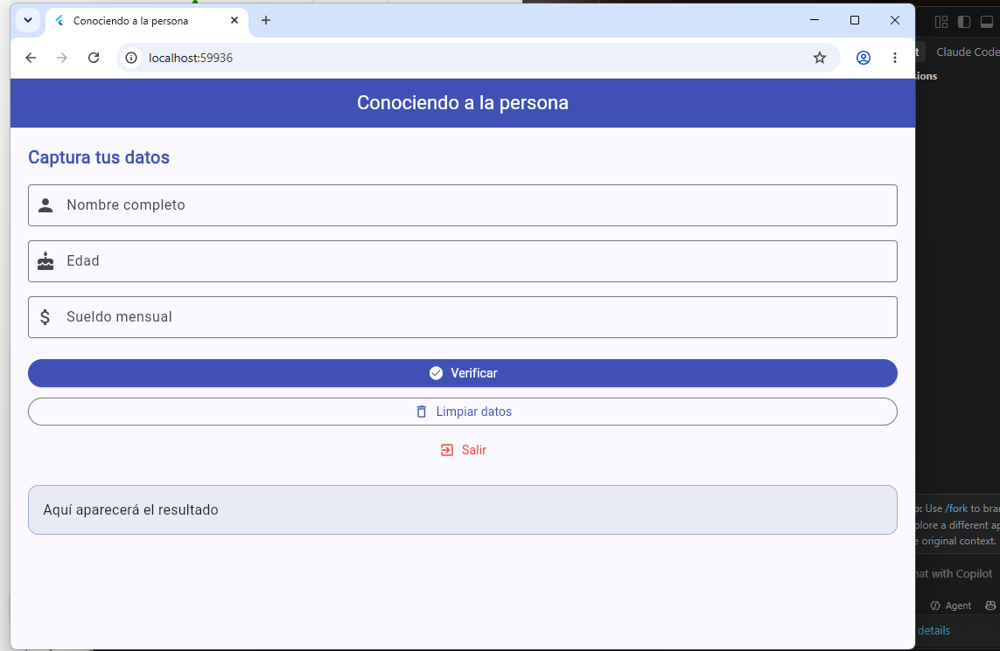
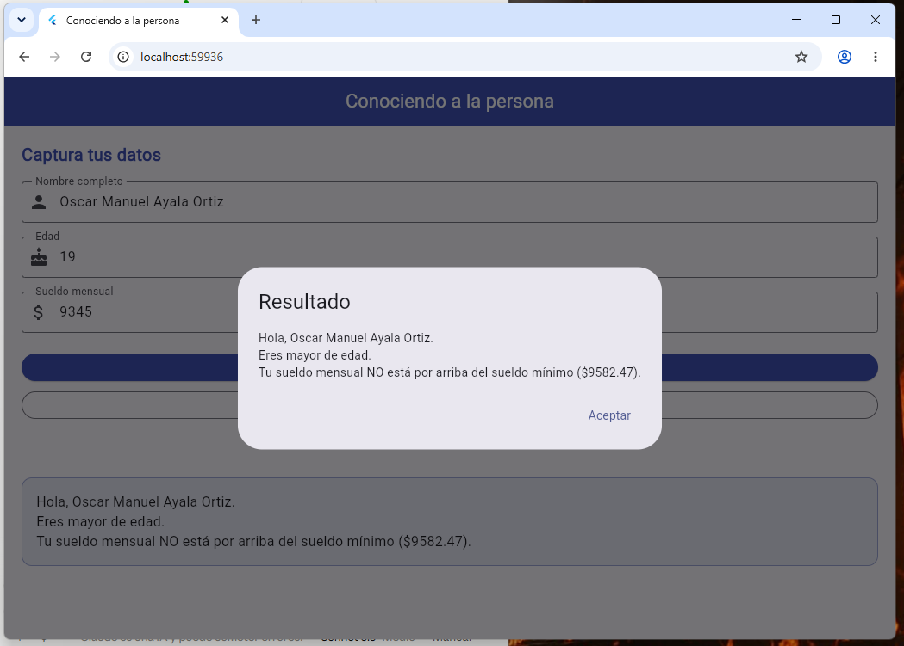
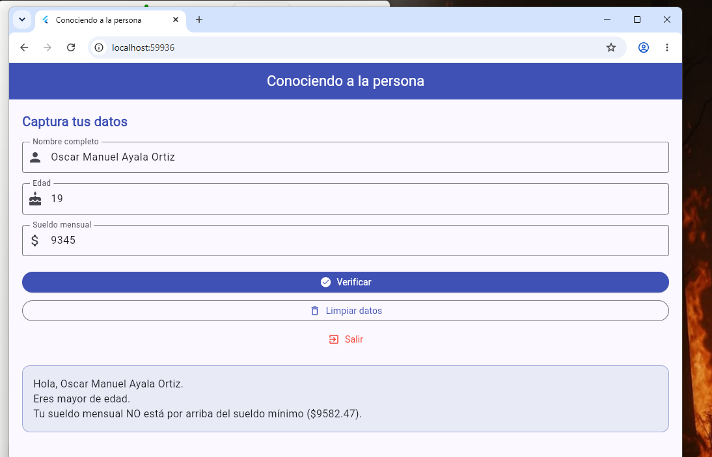

# Práctica 1 · Conociendo a la persona

App en Flutter/Dart que captura nombre, edad y sueldo mensual, valida los datos y dice si la persona es mayor de edad y si su sueldo está por arriba del sueldo mínimo ($9,582.47).

- **Alumno:** Oscar Manuel Ayala Ortiz
- **Grupo:** GTID244 · **Núm. de control:** 1225100784
- **Materia:** Desarrollo de Aplicaciones Móviles (UTNG)

## Qué hace

- Si falta algún dato, muestra el diálogo "Datos incompletos".
- Mayor de edad: 18 años o más.
- Sueldo "por arriba" del mínimo: estrictamente mayor a $9,582.47 (si es igual, NO está por arriba).
- Muestra el resultado en un diálogo y también en una etiqueta en pantalla.
- **Limpiar datos** vacía los campos y la etiqueta. **Salir** cierra la app (solo funciona en Android).

## Cómo ejecutarla

```
flutter pub get
flutter run -d chrome
```

## Evidencia de funcionamiento

| Estado inicial | Diálogo de resultado | Etiqueta con el resultado |
|---|---|---|
|  |  |  |

## Pruebas realizadas

| # | Entrada | Resultado |
|---|---|---|
| 1 | Ana Torres · 17 · 8000 | Menor de edad; sueldo NO por arriba |
| 2 | Luis Pérez · 18 · 9582.47 | Mayor de edad; sueldo NO por arriba (es igual) |
| 3 | Carla Ruiz · 30 · 9582.48 | Mayor de edad; sueldo SÍ por arriba |
| 4 | María López · 45 · 25000.50 | Mayor de edad; sueldo SÍ por arriba |
| 5 | Campos vacíos | Diálogo "Datos incompletos" |
| 6 | Limpiar datos | Campos y etiqueta vacíos |
| 7 | Salir | En web no cierra (`SystemNavigator.pop()` solo funciona en Android) |
